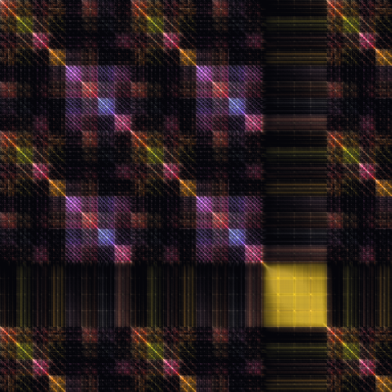
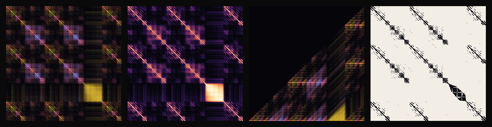

# Reprise

**Turn a song into a picture of its own structure.**

Drop an audio file into Reprise and it draws a square in which *both axes are time*. Every pixel compares one moment of the song with another. Wherever the music repeats (a chorus coming back, a riff looping, a beat ticking), the picture shows a line, a block or a checkerboard. The colors come from the sound itself: harmony sets the hue, loudness sets the brightness, and tonality sets the saturation.

All analysis happens in your browser. Audio files you open never leave your device. Optionally, a deployment can include a small server that fetches the audio of a **YouTube link** you paste; see [YouTube links](#youtube-links-optional-server).

<p align="center"></p>

<p align="center"><sub>The built-in demo piece (form A B A B C A) in the default <i>bloom</i> mode.</sub></p>

---

## How to read the picture

Time runs from the top-left corner to the bottom-right, on both axes. The pixel in row **a** and column **b** answers one question: *how much does the moment at time a sound like the moment at time b?* Bright and colored means "a lot". Dark means "not at all".

| What you see | What it means |
|---|---|
| **The main diagonal** (top-left to bottom-right) | Every moment compared with itself, which is always a perfect match. It shows the song's own color timeline: the present moment. |
| **Lines parallel to the diagonal** | A passage that comes back. Their distance from the diagonal is *how much later* it returns. These are the echoes of the past and the future. |
| **Squares on the diagonal** | A stretch where the sound stays consistent: a section, a held chord, a drone. |
| **Squares away from the diagonal** | A whole section returning later, such as the second chorus matching the first. |
| **Checkerboards** | Two kinds of material taking turns, like verse/chorus or A/B. |
| **Fine hatching inside blocks** | Repetition on a small scale: beats, arpeggios, riffs. |
| **Dark areas** | Moments with nothing in common. |

The image is symmetric, because "a sounds like b" is the same statement as "b sounds like a".

### Render modes

<p align="center"></p>

- **bloom** (the default): each moment has a color derived from its sound, and pixel (a, b) blends the colors of a and b by how similar they are. Similar moments glow in their shared color, and dissimilar ones fall into the dark.
- **heatmap**: the classic scientific similarity plot, drawn through the palette's color ramp.
- **lag**: time runs left to right, and the height is *how far back you look*. A passage that repeats 16 seconds later becomes a horizontal line 16 seconds up. The empty triangle would mean looking back before the song started.
- **print**: a thresholded black-and-white recurrence plot that reads like an etching. It inks only pairs where each moment is among the other's closest matches.

### Controls

| | |
|---|---|
| **Hover** over the image | A tooltip shows the two moments the pixel compares, e.g. `0:42 ↔ 1:58`, and guides point back to both of them on the diagonal. |
| **Click** | Seek to that moment (the column's time) and play. While playing, a cross-hair moves along the diagonal at (t, t). |
| **Space** / **← →** | Play/pause, and jump 5 s back or forward. |
| **youtube** | Paste a YouTube link, or paste or drop one anywhere on the page. Shown only when the optional server is deployed. |
| **listen to** | Compare moments by **harmony** (notes and chords), **timbre** (tone color), or **both**. |
| **color** | **relative** (default) spreads this song's own harmonic range across the color wheel. **absolute** gives the same harmony the same hue in every song. |
| **Palette dots** | Spectrum, Nocturne, Ember, Ink, Paper. |
| **enhance** | Smooths along the diagonals so repeated passages read as clean lines. |
| **export** | Saves a **4096 × 4096 PNG** rendered at full resolution (not upscaled). That's about 35 cm square at 300 dpi. |
| **Touch** | Tap to seek. Press and hold, then drag, to see the tooltip. |

The controls fade away after a couple of seconds without input, leaving only the artwork. Your mode, palette and other choices are remembered in your browser.

---

## How it works

The analysis pipeline is a set of pure TypeScript functions (`src/analysis/`) with no DOM access. It runs in a Web Worker in the app and in Node for the tests. All DSP is hand-written, with no runtime dependencies.

### 1. Decoding

The browser decodes the file with the Web Audio API (`decodeAudioData` through an `OfflineAudioContext` at **22 050 Hz**, which resamples for free) and the channels are averaged to mono. Decoding is the only heavy step on the main thread, because workers have no audio context. Everything after it happens in a worker.

### 2. Short-time analysis

The signal is cut into overlapping frames of **2048 samples** (93 ms, Hann window) every **512 samples** (23 ms), about 43 frames per second. Each frame goes through a radix-2 FFT. The real-input FFT packs the n real samples into an n/2-point complex FFT, which is roughly twice as fast. From each frame's power spectrum we take:

- **Chroma** (12 values: harmony and melody). Rather than folding every FFT bin onto a pitch class, which smears low notes because the window's main lobe is wider than a semitone there, we pick **spectral peaks** between 55 Hz and 5 kHz. Each peak's frequency is refined by fitting a parabola through the log power of the peak bin and its two neighbors. The refined frequency becomes a fractional MIDI pitch *m = 69 + 12·log₂(f/440)*, and the peak's magnitude is split between the two nearest pitch classes.
- **MFCC** (13 values: timbre). The power spectrum passes through 40 triangular filters spaced evenly on the mel scale (*mel = 2595·log₁₀(1 + f/700)*). Then we take the logarithm and an orthonormal DCT-II, and keep coefficients 1–13. Coefficient 0 is overall loudness, which we track separately.
- **RMS** (loudness).
- **Spectral flatness**: geometric mean ÷ arithmetic mean of the power spectrum. It is about 0 for a pure tone and about 0.56 (e^−γ) for a single frame of white noise.

### 3. Time bins

To keep the matrix around 2048 × 2048 even for long songs, frames are pooled into **N ≤ 2048 equal-length time bins**. The bins are uniform rather than beat-synchronous, so both axes stay linear in time.

- Chroma is averaged per bin and L2-normalized.
- MFCCs are **z-scored per coefficient** over the song's non-silent bins, then L2-normalized. Without this step every frame shares the song's average timbre and everything looks alike.
- RMS is pooled as a root mean square and converted to dB.
- Bins more than 50 dB below the song's loud parts count as silence.

### 4. The self-similarity matrix

For bins *i* and *j*:

> **S[i][j] = (1 − λ) · (w_c · cos(chroma_i, chroma_j) + w_m · cos(mfcc_i, mfcc_j)) / (w_c + w_m) + λ · exp(−|dB_i − dB_j| / 6)**

- The weights are **harmony** (w_c, w_m) = (1, 0), **timbre** (0, 1), and **both** (0.6, 0.4).
- λ = 0.1. Loudness is a single number per moment, so a cosine on it would always be 1; a distance kernel is the meaningful equivalent.
- The weighted average is computed in a single pass. Each unit-length feature block is scaled by √(w/Σw) and the blocks are concatenated; the dot product of two such rows *is* the weighted average of cosines.
- Silence matches silence and nothing else.
- Only the upper triangle is computed.

**Path enhancement** (the `enhance` toggle) averages S along each diagonal over about 1 second, computed with running sums in O(N²). A real repetition is a *line* along that direction, so it survives the averaging, while isolated coincidental matches are diluted. The result is mixed 50/50 with the raw matrix so that block structure survives.

Raw cosine values often sit in a narrow band, so the matrix is **contrast-stretched**: its 5th percentile maps to 0 and its 99th to 1, followed by a gamma of 1.6.

### 5. Color

Every time bin gets a color in **OKLCH**, a perceptual color space in which lightness, colorfulness and hue can be set independently:

- **Hue** comes from where the harmony sits on the **circle of fifths**. Pitch class *p* sits at angle 2π·(7p mod 12)/12, so C, G, D, A… are neighbors. The hue is the chroma-weighted circular mean of those angles, with squared weights to favor the dominant notes, smoothed over about 0.4 s. Harmonically related chords therefore get related colors, and the tritone sits on the opposite side of the wheel.
- **Lightness** comes from loudness, as a percentile within the song.
- **Saturation** comes from tonality: low spectral flatness combined with a focused pitch profile (the length of that circular mean). Drums and noise come out greyish, and sustained harmony comes out vivid.

**Relative color** (the default). Most songs stay in one key, whose notes are neighbors on the circle of fifths, so the absolute mapping above reaches only about a quarter of the wheel, and dense mixes (drums, distortion, reverb) look noisy and come out desaturated. Relative mode adapts the colors to the song:

- **Hue:** the circle is cut at the widest gap the song never visits, and the song's hues are unwrapped and spread over up to 300° of the wheel. Half of the spreading is rank-based (histogram equalization, so every color gets used) and half is linear (so big harmonic jumps still look bigger than small ones). The mapping is monotonic, so harmonic neighbors keep neighboring colors, and the song's typical harmony stays at the center, so the key still sets the overall color. Stretching is capped at 4×, so a nearly static song doesn't turn tiny wobbles into a rainbow.
- **Saturation:** a moment is at least as saturated as its tonality *rank* within the song, so the song's most tonal passages always get full color.
- Silence is ignored when measuring the song.

On a one-key test signal with a dense mix, this widens the hue range from about 95° to about 300°.

In **bloom** mode, pixel (i, j) starts from the palette background and moves toward the OKLab midpoint of the two moments' colors in proportion to their similarity. Near-identical moments get a small extra lift in lightness (the glow). Colors are gamut-mapped by reducing chroma, and the conversion to 8-bit sRGB uses a lookup table indexed by √value, which gives fine resolution in the darks where banding would show.

### 6. The other views

- **Lag**: L(t, ℓ) = S(t, t − ℓ), with lag 0 at the bottom.
- **Recurrence (print)**: R[i][j] = 1 when *j* is among *i*'s closest 8% of moments **and** *i* is among *j*'s. These are mutual nearest neighbors, found per row with quickselect. A per-row threshold, rather than one global cut-off, lets quiet passages leave marks next to loud ones.

### Performance

Measured in Node for a 6-minute song. Browsers are similar.

| Step | Time |
|---|---|
| Features (FFT, chroma, MFCC, flatness) | ≈ 0.7 s |
| 2048² matrix, enhancement, first paint | ≈ 0.5 s |
| Change palette or mode (repaint only) | 30–150 ms |
| Change harmony/timbre or enhance | ≈ 0.4 s |
| 4096² poster export | 1.0–1.8 s |

The worker caches every stage and invalidates only what a change touches: a palette or mode change is a repaint only, and the FFT pass never re-runs for the same song.

---

## Running it

Requires Node **22.12+** (or 24+).

```bash
npm install
npm run dev      # http://localhost:5173
npm test         # unit tests (Vitest, Node)
npm run build    # type-check + production build into dist/
npm run preview  # serve the production build
```

The production build is a static site (`dist/`), about 50 kB of JavaScript and CSS, that can be hosted anywhere.

### Deploying

```bash
npm run deploy                                          # tests, builds, rsyncs to ssh host "ct-reprise"
DEPLOY_HOST=user@host DEPLOY_PATH=/var/www/reprise npm run deploy
```

`scripts/deploy.sh` runs both test suites and builds. It then uploads the new hashed assets first, then `index.html`, then removes stale files, so nobody mid-deploy loads a page whose scripts aren't there yet. Next it syncs `server/` and `deploy/` to `/opt/reprise` and runs `deploy/provision.sh` with sudo. That script is idempotent: it installs nginx, ffmpeg, yt-dlp and Deno (checking their published SHA-256 sums), plus the `reprise-api` service, the update timer and the nginx site. Finally it health-checks both the page and the API. The SSH user needs passwordless sudo on a Debian/Ubuntu host.

For purely static hosting (no YouTube option), serving `dist/` is enough: give `/assets/` a long immutable cache and `index.html` `Cache-Control: no-cache`.

### YouTube links (optional server)

Browsers can't read YouTube's audio directly, so a deployment can add a small API (`server/reprise_api.py`, Python standard library only) behind nginx:

1. The browser sends the link to `POST /api/youtube`.
2. The server keeps **only the 11-character video ID** and rebuilds a canonical `https://www.youtube.com/watch?v=<id>` URL itself. User text never reaches `yt-dlp`, so there are no other sites, no playlists and no command injection.
3. [`yt-dlp`](https://github.com/yt-dlp/yt-dlp) downloads the audio stream, preferring stereo m4a. If there is none, ffmpeg transcodes to AAC. yt-dlp needs [Deno](https://deno.com) for YouTube's JavaScript challenges.
4. nginx serves the file from a cache (`/api/audio/<id>.m4a`, with range requests for seeking), and the browser analyzes it like any other file.

Limits:
- Videos must be 20 minutes or shorter, and live streams aren't accepted.
- At most 150 MB per file and 2 downloads at a time.
- At most 12 requests per 10 minutes per client.
- The cache holds up to 1.5 GB and keeps files for up to 7 days.

A daily systemd timer updates yt-dlp and Deno, because YouTube changes often and an outdated yt-dlp stops working. The page detects the server through `GET /api/health`; on purely static hosting the YouTube option simply doesn't appear.

> **Note:** YouTube's Terms of Service don't allow downloading except through YouTube's own features, and most music on YouTube is copyrighted. The YouTube option is meant for personal or internal deployments; think twice before exposing it publicly.

For development against a deployed server: `REPRISE_API=http://<host> npm run dev` proxies `/api` there.

### Browser support

Current Chrome, Edge, Firefox and Safari. It needs ES2022, module Web Workers, `OfflineAudioContext` and Canvas 2D. Which formats decode depends on the browser: mp3, wav and m4a/AAC work broadly, while ogg/opus support varies by browser and version (older Safari can't decode them). If a file won't decode, Reprise says so.

## Project structure

```
src/
  analysis/   pure DSP: fft, framing, chroma, mel, mfcc, spectral, features,
              aggregate (binning), similarity, enhance, lag, recurrence, pipeline
  color/      oklab (color math), frameColor (circle of fifths → color), palettes
  render/     painters: bloom, heatmap, lag, print (matrix → RGBA)
  worker/     engine (cached pipeline), worker adapter, protocol, promise client
  audio/      decode, player, wav encoder, youtube (API client),
              demo (synthesized A B A B C A piece)
  ui/         app wiring, stage, overlay, pointer, timeline (pure), controls,
              export, settings, progress, dropzone, styles
tests/        Vitest suites on synthetic signals (no browser needed)
server/       optional YouTube audio API (Python stdlib) and its unittest suite
deploy/       nginx site, systemd units, idempotent provision.sh
docs/         README images, rendered from the demo
```

## Tests

`npm test` runs 77 tests on synthetic signals, and `python3 -m unittest discover -s server` runs the API's tests, with a stand-in for yt-dlp so no network is needed:

- **FFT**: matches a naive DFT and satisfies Parseval's theorem.
- **Chroma**: a pure sine (A4, C4, G3, F♯5) gives a constant chroma peak at its pitch class in every frame, clearly dominant.
- **Repetition**: a random melody repeating every 3.7 s, and frozen noise repeating every 2.3 s, produce their strongest off-diagonal line at exactly that lag (±1 bin).
- **No structure**: white noise produces a flat lag profile in every mode. Prominence is measured in units of the matrix's own off-diagonal spread, because the modes have very different raw ranges.
- **Features separate what they should**: chroma groups the same pitch across timbres, and MFCC groups the same timbre across pitches.
- **Color**: OKLab round-trips; gamut mapping stays in sRGB; C→G is a 30° hue step and C→F♯ is 180°; noise is less saturated than tones; louder moments are lighter.
- **Relative color**: a one-key song spreads from under 95° to over 280° of the wheel; harmonic order is preserved, even across the 0/1 seam; near-static songs stay near-static; the song stays centered on its typical harmony; silence is ignored.
- **Painters**: bloom's diagonal is the color timeline; lag turns a diagonal into a horizontal line; print is symmetric and sparse; enhancement keeps stripes and dilutes isolated spikes.
- **Engine**: each change recomputes only what it invalidates; export renders natively without disturbing the on-screen state.
- **Timeline**: pixel ↔ time mapping and the tooltip text (`0:42 ↔ 1:58`, `0:42 · echo of 0:12 (lag 0:30)`).
- **YouTube links**: the browser and server parsers accept the same link shapes and reject look-alike hosts, other schemes, playlists and injection attempts. The server side also covers caching and pruning, error messages, rate limiting, and the canonical URL that yt-dlp receives.
- **Demo**: deterministic, and its repeated sections are measurably more alike than its different ones.

## Limitations

- Time bins are uniform rather than beat-synchronous. A song with a drifting tempo draws slightly curved repetition lines.
- Chroma assumes A = 440 Hz tuning. Recordings tuned far from that blur between neighboring pitch classes.
- The whole file is decoded into memory. A 4096² export needs a few hundred MB of memory in the worker, which can be too much for very old phones.
